# workstation-steward

[](https://www.npmjs.com/package/workstation-steward)
[](https://github.com/pacphi/workstation-steward/actions/workflows/test.yml)
[](LICENSE)

**Your Mac's software supply chain, kept current on your terms.** One command, `steward`, looks after your mise
toolchain, Homebrew, apps, the App Store, macOS, trust stores and Docker, and, if you want, your AI tools and every
project under your development folders. Each week it answers one question: *what needs updating, is it safe yet, and
what changes if I say yes?*



> [!IMPORTANT]
> workstation-steward is 0.x and runs on macOS. Linux and Windows follow, one package manager at a time
> ([`docs/lifecycle.md`](docs/lifecycle.md#platforms)).

## Why it's different

The steward aims for *safe, explained and reversible*, not merely *newest*.

- **Nothing changes without asking.** Every command that writes shows its plan, waits for your yes, backs up first,
  writes a receipt, and has a way back (`--rollback`, `--undo` or `steward sc rollback`). There are no background jobs
  and no auto-updates; `DRY_RUN=1` previews anything.
- **New releases wait.** A version comes in once it is 3 days old (you choose the number, once, in `steward.toml`),
  so a hijacked or broken release has time to be caught. The exception is the first patched release for an advisory
  in the GitHub Advisory Database, RustSec or OSV. Majors are always your call. Even the steward itself waits.
- **The old version stays for a while.** After an upgrade, a Node patch or a reinstall, the previous install stays on
  disk through a soak (3 days by default), so going back is a config restore, not a reinstall.
- **Your data stays yours.** The engine holds none of it. Your config (an *instance*: roots, policy, the registry of
  your projects) lives in your own folder, best kept in a private Git repo.
- **Releases you can verify.** Every release from 0.1.0 is published from CI through npm Trusted Publishing, with a
  SLSA provenance attestation linking the package to the exact commit and workflow that built it.

## See it work

### The weekly review

`steward review` runs every area's read-only checks and returns one list of what needs you, each item with the command
that acts on it. The `steward` banner says when a review is due.



### A safe upgrade, and its undo

`steward sc upgrade` takes only what passed the gate, asks before acting, backs up your mise config, upgrades without
pruning, and verifies every tool. `steward sc rollback` puts the config back.



### Patching Node

A Node release that can't wait goes through `steward sc node-patch`: it checks the official tarball against
nodejs.org's checksums, confirms the installed binary is byte-identical, reinstalls the global CLIs the steward manages
(its npm -g *hybrids*) one by one, and keeps the previous Node for a rollback.



### PR consolidation, in Claude Code

`/steward:pr-consolidation` turns a repo's pile of Dependabot and Renovate PRs into one PR with every CI audit green:
in-major bumps past the age gate, majors deferred with their breaking changes written up, and every exception
justified. This animation retells a real run,
[`pacphi/ampel#86`](https://github.com/pacphi/ampel/pull/86).



## Quick start

**1. Check the release, then install it through mise**, so the same gate and Renovate keep the steward current:

```sh
npm view workstation-steward@<version> dist.attestations.provenance.predicateType   # https://slsa.dev/provenance/v1
mise use -g 'npm:workstation-steward[allow_low_downloads=true]@<version>'
```

> [!NOTE]
> By default, mise's npm installer refuses a package name younger than 30 days unless you approve it, which is what
> `allow_low_downloads=true` does. `workstation-steward` turns 30 days old on 2026-11-27; after that the approval
> changes nothing. Check the provenance first, as above.

**2. Create your config.** `steward init` copies the example instance to `~/.config/workstation-steward`, shows every
file it will write, and asks. Then it walks the rest of setup one question at a time (the AI tooling add-on, the
projects add-on and where your projects live, the Claude Code skills), and each answer changes one line of
`steward.toml`.

```sh
steward init
```

**3. See where you stand.** Both are read-only:

```sh
steward doctor        # what this machine still needs (mise, Homebrew, gh …), and --install to fix it
steward sc plan       # what an upgrade would take, hold or skip, and why
```

> [!TIP]
> `steward` on its own lists every command and tells you when something needs you: new projects, a soak ending, a
> review due. `steward check` says whether your config is in a format this release reads.

Working on the steward itself? Run it from a clone with `node bin/steward.js`, or as `steward-dev` alongside a pinned
release ([`docs/lifecycle.md`](docs/lifecycle.md#two-channels)).

## What it looks after

| Area | Covers | Commands |
| --- | --- | --- |
| [Supply chain](supply-chain/README.md) | mise tools and mise itself, npm -g CLIs, Homebrew, apps and their bundled runtimes, the App Store, macOS, trust stores, Docker, indicators of compromise | `steward sc …` |
| [AI tooling](ai-tooling/README.md) (add-on) | Ruflo and AgentDB, AQE, RuvNet Brain, RuVector: qualification before a version reaches a project, launchers, guards, drift | `steward ai …` |
| [Projects](projects/README.md) (add-on) | Every project under your roots, a registry of your decisions, onboarding each project's chosen tools | `steward projects …` |
| [Fleet](fleet/README.md) | The GitHub side: Renovate patterns, consolidating dependency PRs, bringing checkouts level after merges | `steward fleet …` |

The add-ons are off until you turn them on, in `steward init` or in `steward.toml`.

## Claude Code skills

The steward ships as a Claude Code plugin, `steward`, with one skill per area. Each follows the runbook (or, for PR
consolidation, the rules) beside it, and asks before anything that changes your machine.

| Skill | What to ask it |
| --- | --- |
| `/steward:supply-chain` | "what needs updating", "audit the machine", "a Node security release is out" |
| `/steward:ai-tooling` | "is the AI tooling OK", "qualify AQE 3.15.x" (with the AI tooling add-on) |
| `/steward:projects` | "what new projects are there", "onboard this repo" (with the projects add-on) |
| `/steward:pr-consolidation` | "consolidate the Dependabot PRs in owner/repo" (with `[skills] pr_consolidation`) |

`steward skills install` installs it for you (every session) or, with `--project <path>`, for one project. The plugin
runs your installed `steward` to build itself each session, so the skills always match your version and the add-ons
you've turned on.

> [!CAUTION]
> Run `steward skills install` in your own terminal, not from inside a Claude Code session. Claude Code accepts a
> plugin's command only from a person, so the install stops and tells you so.

## Read next

| Doc | What it covers |
| --- | --- |
| [`docs/guide.md`](docs/guide.md) | Why the steward exists, the first run, and a normal week |
| [`docs/lifecycle.md`](docs/lifecycle.md) | Install, upgrade, config formats, rollback, the two channels, and the promises behind them |
| [`docs/architecture.md`](docs/architecture.md) | How it's built, and every design decision with its reason |
| [`docs/prereqs.md`](docs/prereqs.md) | What the steward needs on the machine (`steward doctor` checks it) |
| [`examples/README.md`](examples/README.md) | What goes in your instance |
| [`docs/maintainers.md`](docs/maintainers.md) | How releases are made, published and checked on a clean Mac |
| [`docs/README.md`](docs/README.md) | Every doc, the runbooks and the skills |

## Repository layout

| Path | What it is |
| --- | --- |
| `bin/steward.js`, `lib/commands.js` | The `steward` client and its list of commands |
| `lib/` | Shared code: configuration and the instance, bash helpers, discovery, onboarding, the soak, the review, the skills plugin |
| `supply-chain/`, `ai-tooling/`, `projects/`, `fleet/` | Each area's scripts (`bin/`) and README |
| `skills/`, `.claude-plugin/` | The Claude Code skills, each with its runbook, and the plugin and marketplace manifests |
| `examples/` | A complete example instance; the tests run against it |
| `docs/` | The guide, design, lifecycle, prerequisites and maintainer docs; `docs/assets/` holds these animations |
| `tools/`, `justfile`, `test/` | Developer tasks: `just test`, `lint`, `docs`, `leak-check`, `release-worktree`, `terminal-svg` |
| `package.json` | The npm package: engine files only, no dependencies |

The steward keeps its own state outside any repo: receipts and backups in `~/.local/state/workstation-steward/`
(mode 0700), and copies of your mise config in `~/.config/mise/backups/` before every change.

## Contributing and security

[`CONTRIBUTING.md`](CONTRIBUTING.md) covers setting up, testing against `examples/`, and the shape every changing
command follows. Report vulnerabilities privately: [`SECURITY.md`](SECURITY.md). MIT licensed ([`LICENSE`](LICENSE)).
