# AI tooling

Ruflo and AgentDB, AQE (the shared patched runtime and the CLI), RuvNet Brain, RuVector, `@claude-flow/codex`,
agent-browser, the shared launchers under `~/.local/share/ai-tooling`, the machine-wide guards, and each
project's AI launchers. These tools install through mise or the npm -g hybrids, but this area owns them:
`steward sc upgrade` skips them, and Renovate opens their PRs only when you tick them on the Dependency
Dashboard (security PRs still open at once).

Not every project uses these tools, and none has to. Each project's choice lives in
`projects/registry.toml` in your instance ([an example](../examples/projects/registry.toml)), and drift checks only what a project chose.

A normal day here: `steward ai drift` compares the machine and every project with your policy and changes nothing.
When a Node patch leaves launcher configs pointing at the old Node's folder, `steward ai repin` shows the files it
would move to a path that survives upgrades, then `--apply` asks, backs each file up and writes a receipt for the
rollback.



## Policy

The area can be switched off with `ai_tooling = false` under `[profiles]` in `../steward.toml`.

`ai-tooling.toml` in your instance ([an example](../examples/ai-tooling/ai-tooling.toml)) records what should be true:

- the owned packages;
- the expected AQE runtime release and its patches;
- the shared Ruflo launcher;
- the auto-update guard;
- the rule that launchers never use `@latest`;
- the upstream threads to watch.

The qualification recipe behind those values is in
[`../skills/ai-tooling/qualification.md`](../skills/ai-tooling/qualification.md); how upstream fixes retire local patches,
and how projects are kept in step after a promotion, in
[`../docs/ai-tooling/upstream-and-reconcile.md`](../docs/ai-tooling/upstream-and-reconcile.md).

Procedures: [`../skills/ai-tooling/runbook.md`](../skills/ai-tooling/runbook.md). Claude skill:
[`../skills/ai-tooling/`](../skills/ai-tooling/README.md) (`ai-tooling`).

## Commands

```sh
steward ai drift              # read-only: machine and per-project AI tooling vs policy; changes nothing
steward ai drift --offline    # skip the npm registry and GitHub reads
steward ai drift --json       # machine-readable results
steward ai fix                # repin, guard, timeouts, approvals and transport: every plan, then one yes (D61)
steward ai repin              # plan: launcher configs to move from version-specific to stable paths
steward ai repin --apply      # the same plan, then asks; backs up each file, checks the parse, writes a receipt
steward ai repin --apply --tracked-local <file>...   # also tracked files whose pins come only from local edits (D13)
steward ai repin --rollback <receipt>   # restore those files (refuses any changed since)
steward ai timeouts            # plan: hook timeouts written in milliseconds (the field is seconds), in project settings
steward ai timeouts --apply    # the same plan, then asks; backs up each file, checks the parse, writes a receipt
steward ai timeouts --rollback <receipt>   # restore those files (refuses any changed since)
steward ai approvals           # plan: Codex MCP settings the policy sets (Brain's ruvnet_cli_run must prompt; a stable node, not a bare one)
steward ai approvals --apply   # the same plan, then asks; backs up each file, checks the parse, writes a receipt; --rollback <receipt> undoes it
steward ai guard               # plan: npx ask rules (D27), git ignore rules (D28), plugin store keys such as ruflo-console's updater off (D29)
steward ai guard --apply       # the same plan, then asks; backs up, checks the parse, writes a receipt
steward ai guard --rollback <receipt>   # restore the settings file (refuses if it changed since)
steward ai transport           # plan: the AQE hook transport v2 in the shared runtime against its source (D24)
steward ai transport --apply   # install it (asks; backs up a different copy; receipt); steward ai transport --rollback <receipt>
```

The repin rules (`[[repin]]` in `ai-tooling.toml`) map version-specific install paths to ones that survive
upgrades and prunes: `node/26/…` and `npm-ruvector/0.3/…`. The command never uses mise shims. It edits only
files Git doesn't track; tracked files are listed for a PR.

**What `drift` checks:**

- **Machine:**
  - the AQE runtime's `current` release;
  - what `aqe`, `aqe-mcp` and `agentic-qe` resolve to on `PATH`;
  - `ruflo-core`'s `current` release;
  - hybrid receipts;
  - `CLAUDE_FLOW_AUTO_UPDATE=false`;
  - the Brain knowledge base's age;
  - a tool switched on per project only that is on at user level instead: Brain's Claude plugin, Codex plugin or
    Codex MCP server, or a Ruflo Claude plugin, in `~/.claude/settings.json` or `~/.codex/config.toml` (D55; the
    `[user_off]` table in each profile);
  - AQE releases newer than the runtime's base, with their age against the 3-day gate and whether their
    notes mention security;
  - the watched upstream threads;
  - launcher configs pinned to a version-specific install folder (for example `node/26.4.0/…`): they keep
    running that version after upgrades and break when it's pruned;
  - launcher configs naming a path under `~/.local/share` that doesn't exist (a layout change in a new
    version, or a missing Ruflo memory-hook `distPath`).
- **Each project:**
  - tools it shows beyond the ones it chose;
  - launchers that fetch `@latest`;
  - AQE servers not on the shared runtime: an explicit path into it counts, and so does a bare `aqe-mcp` while a
    fresh shell resolves it there (D33);
  - AQE hooks without the hook shim;
  - Ruflo without `claudeFlow.daemon.autoStart: false`;
  - hook timeouts written in milliseconds (one summary line; `steward ai timeouts` fixes them);
  - Codex MCP settings off the policy: an auto-approved `ruvnet_cli_run`, a bare `node` launcher (one summary line; `steward ai approvals` fixes them).

  Until a project's decision is confirmed, these use its seed.
- **Not covered yet:** config files below a project's root (for example `scripts/.mcp.json`), and Codex-side
  hooks.

Changing commands (qualify, promote, repin a launcher) arrive in P5, each with a plan, `[y/N]`, a backup and a
receipt.
