# The briefing: `steward brief`

 

**One question, answered in under a second: what needs me, and what do I run next?** `steward brief` reads what is
already on your disk and names **one** next step, with its exact command. When nothing needs you, it says so in one
line.

```text
$ steward brief
steward config: 1 newer commit(s) on origin/main (as of 2026-10-30 09:12): supply-chain/hybrids.toml
next: steward config sync, then steward sc install-hybrids
+1 more: steward brief --all
```

A step that stopped midway comes first, in red, and its next step finishes it (real commands and output, example
names):



> [!IMPORTANT]
> The briefing never fixes anything. It reads, and it tells you. Every command it names still shows its plan, asks for
> your yes, backs up first and writes a receipt.

## Why it exists

The pieces were already there: the `steward` banners, `steward review`, `steward check` and the receipts each command
writes. But they were spread out, some were slow, and none of them noticed when a step went wrong or ran out of
order. For example:

- the hybrids were installed **before** the config sync that brought their new versions;
- a promote stopped halfway and left a half-copied release behind;
- a config sync stopped with your edits set aside in `git stash`.

Each of these leaves evidence on disk. The briefing reads that evidence and names the step that finishes the job, or
the receipt's way back.

## What it reads

The briefing itself is local: it uses no network and starts no slow scan. What needs the network or a long walk comes
from the notes of [the background refresh](#the-background-refresh).

| Source | Where |
| --- | --- |
| The soak | the receipts under `[paths] state` (the same as `steward sc soak`) |
| Your config repo | `git status` and the commits GitHub has, **as of the last fetch** (`steward review` and the background refresh fetch) |
| The npm -g hybrids | each receipt in `<state>/hybrids/` against `supply-chain/hybrids.toml` |
| The shared AQE runtime | what `current` points at, the `releases/` folder and `[aqe]` in `ai-tooling/ai-tooling.toml` (AI tooling add-on) |
| Every receipt and backup | `<state>/backups/*` |
| Projects behind the AI tools | what the last full `steward projects reconcile --all` noted (it never plans again) |
| The release-age gate | the queue the last `steward review` saved |
| The weekly review | when the last one ran |
| The background refresh's notes | `<state>/brief/refresh.json`: your config repo fetched, the newest steward on npm, new projects, AI tooling drift, the active Node |

The briefing writes nothing itself. After it prints, it may start the background refresh, which writes only its own
notes.

### Old caches wait

Three of these are caches: the gate's queue (`steward review`), the projects behind (the last full
`steward projects reconcile --all`) and the background refresh's notes. When a cache is older than `stale_hours`, its finding says "as of" when it
was written, and it becomes a **wait**: it is shown, but it is never the next step. Run the command that writes it to
bring it up to date. Set the number in your `steward.toml`; `0` means a cache never goes stale:

```toml
[brief]
stale_hours = 48    # the default
```

A finding that compares today's installs, such as "aqe changed since the last reconcile check", is read now, so it
never goes stale.

## What it checks

Each check is a **detector**. A detector looks at what was read and either finds something or stays quiet. Each has a
**severity**, which sets the order:

- **fix**: a step stopped midway or broke. These come first.
- **act**: something is out of step, and other steps wait on it.
- **do**: routine work.
- **wait**: nothing for you to do yet. A wait is never the next step.

| Detector | Severity | What it catches | What it names |
| --- | --- | --- | --- |
| `receipt-unfinished` | fix | A receipt still marked unfinished, at least 15 minutes old (a `steward fix` run's or a bundled command's record, D61, only once its process is gone) | The recovery for its kind. A bundled command gets itself again (`steward upgrade`), whose plan shows only the parts left. A config sync gets `steward config sync` and where your set-aside edits are, never `--rollback` (that refuses an unfinished sync) |
| `backup-no-receipt` | fix | A backup folder a steward command made, with no receipt. Hand-made backups and Ruflo policy backups are left alone | For a promote that stopped after the store backup: promote again |
| `aqe-partial` | fix | `releases/<r>.partial` in the AQE runtime | Remove it, then promote again |
| `repin-unfinished` | fix | Maintainers only: the release channel isn't at the commit the last repin receipt names | Finish the repin, or its rollback |
| `aqe-vs-policy` | act | AQE promoted but `ai-tooling.toml` not updated, or the other way round | The matching step: update the policy, promote, or qualify first |
| `hybrid-vs-policy` | act | A hybrid behind, ahead of or missing from `hybrids.toml`, or GitHub has a newer `hybrids.toml`, or a hybrid installed for another Node than the active one (from the refresh) | `steward sc install-hybrids`, after the config sync when one is waiting |
| `config-behind`, `config-changed`, `config-ahead`, `config-pr` | act, do | Your config repo: newer on GitHub (with the files that changed), changed here, not pushed, or a pull request waiting | `steward config sync` |
| `soak` | do, wait | The soak ended, so old installs can be pruned (or it is still running: wait) | The prune, after any hybrid is back in step |
| `projects-behind` | do | Projects behind the qualified AI tools | `steward projects reconcile --all` |
| `projects-new` | do | New projects under your roots, or registered ones gone (from the refresh) | `steward projects scan` |
| `ai-drift` | do | AI tooling drift the other checks don't cover (from the refresh) | The command the drift line names, else `steward ai drift` |
| `gate-cleared` | do | Updates the gate held that have cleared it since the last review | `steward review` |
| `release-newer` | do, wait | A newer steward on npm, past the release-age gate (from the refresh). Before the gate clears it is a wait. Never for a dev clone | `steward sc upgrade-tool npm:workstation-steward`; for the release channel's worktree, `/steward-maintain release X repin X` |
| `review-due` | do | The weekly review is due | `steward review` |

A started step is not called unfinished for its first 15 minutes, since it may still be running. A stopped run that a
later run of the same command finished is history, and isn't shown.

### Steps that wait on another

Some steps only make sense after another. A detector can say so with `after`. When both are found, the later one is
folded into the earlier as "then …", so you see one line in the right order:

```text
config-behind  ←  hybrid-vs-policy  ←  soak
next: steward config sync, then steward sc install-hybrids, then DRY_RUN=1 steward sc prune, then steward sc prune
```

- **Sync before install.** If GitHub has a newer `hybrids.toml`, installing first would install the old policy.
- **Install before prune.** `steward sc prune` refuses until every hybrid has a matching receipt.

## The background refresh

Some questions need the network or a long walk: is GitHub ahead of your config, is there a newer steward, are there
new projects. The briefing doesn't ask them itself, so it stays under a second. A **background refresh** asks them
now and then, and leaves its answers in `<state>/brief/refresh.json` for the next briefing (D57 in
[`architecture.md`](architecture.md#decisions)).

**When it runs.** After `steward brief` prints, it checks how old the notes are. When they're older than
`refresh_hours`, it starts the refresh in the background and returns at once. You never wait for it.
`steward brief --refresh` runs it now instead, with a progress line for each step, then shows the briefing.

**What it does.** Each step only reads:

| Step | What it asks | Time limit |
| --- | --- | --- |
| `config` | `git fetch` in your config repo, when it is a Git repository of its own with an upstream. No prompts: `GIT_TERMINAL_PROMPT=0`, and ssh in batch mode. A fetch changes only `FETCH_HEAD` and what Git knows of GitHub's branches, never your branch or your files | 30 s |
| `npm` | the newest `workstation-steward` on npm, and when it was published | 20 s |
| `projects` | new projects under your roots, and registered ones gone (the projects add-on) | 30 s |
| `drift` | `steward ai drift --offline --json`, its DRIFT and WARN lines (the AI tooling add-on) | 60 s |
| `node` | `mise current node`, from your home folder: the Node the hybrids should be installed for | 5 s |

**Its limits.**

- It runs at low priority, detached from your terminal, and stops after 120 s in all.
- A step that fails or runs out of time is written down with its error, and the other steps still run.
- It writes one file, its notes, by writing a temporary file and renaming it. Only you can read it (mode 0600).
  The tools it asks (git, npm, mise) keep their own caches and logs, as they do whenever you run them.
- A lock file (`refresh.lock`) keeps a second one from starting. A lock older than 10 minutes, or whose process is
  gone, was left by a run that died, and the next refresh takes it over.

**What it never runs:** a full reconcile plan (that writes `seen.json`), the release-age gate's queue (that moves
the review's anchor), `steward sc audit`, `gh`, or anything that installs, upgrades or fixes.

**What it never starts under:** `refresh_hours = 0`, or `STEWARD_NO_REFRESH` or `CI` set in the environment.

**Findings that go quiet when you act.** The notes are up to `refresh_hours` old, so a finding from them must not
nag after you've dealt with it:

- `release-newer` compares with the steward running now, so it goes away once you upgrade.
- `projects-new` says nothing once `projects/registry.toml` changed after the count: a decision you recorded, or a
  config sync that brought one. The next refresh counts again.
- `ai-drift` drops to a wait when a steward command made a backup after the check, since that command may have
  fixed it.
- The Node check in `hybrid-vs-policy` judges only receipts written before the refresh looked at Node. After a
  `steward sc node-patch`, the cached Node may be the old one.

**Settings**, in your `steward.toml`:

```toml
[brief]
refresh_hours = 6   # the default; 0 = never, so nothing touches the network unprompted
fetch = true        # the default; false skips the git fetch of your config repo
```

## Output

| Command | What you get |
| --- | --- |
| `steward` (on its own) | The same lines as `steward brief`, then the help. Before 0.10.0, five separate banners did this job (one walked every project root each time) |
| `steward brief` | At most three lines: what happened, `next: <command>`, and `+N more` when there is more. One quiet line when nothing needs you |
| `steward brief --all` | Every finding, each with its command and why |
| `steward brief --json` | The same as data: `{v, at, next, more, findings}` |
| `steward brief --plan` | The work list: every step that isn't a wait, numbered, in the order to take them, each with [who does it](#who-does-each-step) |
| `steward brief --plan --json` | The work list as data: `{v, at, items}` |
| `steward brief --refresh` | The background refresh run now, with progress, then the briefing |

`more` counts the findings besides `next`; when `next` is null, they are all waits. Each finding has an `id`, a
`severity`, a stable `key` (it changes only when what it points at changes), the `text`, the
`cmd`, `writes` (true when the command can change your machine, projects or config; it still asks first), the `skill`
that covers it, `why`, a `rollback` when there is one, and [`actor` and `class`](#who-does-each-step). Text taken from receipts and paths is cleaned before it is
shown: no control characters or escape codes, your home folder as `~`, and at most 200 characters.

For Claude Code, the engine also wraps the data in a `<steward-brief v="1">…</steward-brief>` block, with four
short rules: offer the finding's skill, show its command exactly, never run a command with `writes: true` without
your yes, and hand a step whose `actor` is `human` to you without running it. [The session-start hook](#in-claude-code-the-session-start-hook) hands that block to Claude.

## In Claude Code: the session-start hook

**A new Claude Code session starts knowing what needs you.** The `steward` plugin
([skills](../skills/README.md#install)) carries one hook. When a session starts, Claude Code runs
`steward brief --hook`. When something needs you, Claude gets the `<steward-brief>` block, so "what's next?" has an
answer at once, and you hear about it once: a broken or half-finished state shows as a notice when the session opens,
and a routine step (a sync, a review due) comes as one line at the end of Claude's first reply. When nothing needs
you, the hook prints nothing.

| How the session started | What the hook does |
| --- | --- |
| A new session, or `/clear`, and nothing needs you | Nothing. Waits alone don't count |
| A new session, or `/clear`, and something needs you | Gives Claude the block **if** what needs you changed since it last showed, or `quiet_hours` have passed. A broken or half-finished state (next is `fix`) also shows you the briefing as a notice (at most three lines); for a routine step, Claude adds one line starting "Steward:" at the end of its first reply. Otherwise you see nothing, and Claude gets one line: what's next, and that you've heard |
| After a compaction (`/compact`, or automatic) | Gives Claude the block again, since the compaction dropped it. You see nothing |
| Resumed (`--resume`, `--continue`) or forked | Nothing: the hook isn't run. The session already has its context |

**When it shows again.** The hook keeps a stamp, `<state>/brief/shown.json`: when it last showed, and a fingerprint
of what needed you (each finding's `id` and `key`, which change only when what they point at changes). A new
finding, or one gone, changes the fingerprint, so the next session shows the briefing at once. The same work still
waiting shows again only after `quiet_hours`. The stamp is the one file the hook writes, by a temporary file and a
rename, readable only by you (mode 0600).

**What it never does.** It uses no network itself and fixes nothing. Like `steward brief`, it may start the
[background refresh](#the-background-refresh) after a new session or `/clear`, and doesn't wait for it. It always
exits 0. If it hasn't answered in 1.5 seconds, it prints nothing and the session goes on (Claude Code's own limit
for it is 5 seconds). If no `steward` is on your `PATH`, it does nothing.

**What Claude is told.** The block is data, not instructions, and the rules with it say: offer the finding's skill,
show its command exactly as written, and never run a command with `writes: true` without your yes. Each skill
starts from the block's `next` when `next.skill` names it, and shows the plan (`DRY_RUN=1`) before any change. The
block stays under Claude Code's limit of 10,000 characters: with many findings, it keeps `next` and the first few,
and says how many it left out (`truncated`).

**Settings**, in your `steward.toml`:

```toml
[brief]
session = true      # the default; false leaves the hook out of the plugin
quiet_hours = 12    # the default; 0 shows the briefing in every new session
```

`session = false` takes effect the next time Claude Code builds the plugin (each session runs `steward skills path`).
The hook also checks it each time, so it stays quiet in the meantime.

> [!NOTE]
> The notice is the hook's `systemMessage`, which Claude Code's docs describe as a warning message shown to the user.
> That's why only a broken or half-finished state uses it; a routine step reaches you through Claude instead, so the
> notice never cries wolf. The stamp keeps either one from repeating.

## Who does each step

**The engine says who does each step, not Claude.** Every finding, every item of the work list (`steward brief
--plan`) and every item of `steward review --json` carries two labels, worked out from its command
(`lib/autonomy.js`, D58):

- **`class`**: what kind of change the step makes, such as `pull` (a config sync that fast-forwards), `reconcile`,
  `prune` or `install-hybrids`. A read-only step has none. `steward config` and `node lib/autonomy.js` list them all.
- **`actor`**: who takes the step.

| Actor | Means | For example |
| --- | --- | --- |
| `agent` | Read-only, or a class your `[autonomy]` level allows. It may run without asking you | `steward review`; under `safe`, `steward config sync` |
| `agent-with-yes` | A steward command that writes, with a plan, a backup and a receipt. It runs only after your yes | `steward sc install-hybrids` |
| `human` | Yours to do. It is handed to you, never run for you | a merge, `sudo`, a trust store, a dashboard tick, a fix "by hand", any shell command the steward didn't write as a `steward` command (`rm -rf`, `mv`) |

A step made of several commands ("`x`, then `y`") gets the label its most demanding part needs. In the work list,
a step that waits on another (its `after`) comes right after it, each with its own command.

### Your `[autonomy]` level

You choose how much may run unattended, in your `steward.toml`:

```toml
[autonomy]
level = "safe"     # ask | safe | maintainer
allow = []         # classes to add, for example ["install-hybrids"]
deny = []          # classes to take away
subagents = 4      # independent items the fix skill may hand to sub-agents at once
```

| Level | Runs unattended |
| --- | --- |
| `ask` | read-only steps only |
| `safe` (the default) | read-only steps, plus `pull` (a config sync that fast-forwards), `reconcile`, `prune` (after the soak), `qualify` (a sandbox qualification), `pr-prep` (a pull request prepared in a scratch clone, not pushed) and `fleet-sync` (fleet sync: a fast-forward after merges) |
| `maintainer` | `safe`, plus `prune-merged` (deleting branches whose PR merged), `release-verify` and `repin`. A class says only that no yes is needed; it doesn't make the step due. A maintainer repins when they ask for it |

Installs, upgrades, Node patches, pushes and pull requests always ask, unless you name their class in `allow`.

> [!IMPORTANT]
> Some things no setting can change. Human-only steps have no class, so nothing can allow them. Every write still
> shows its plan, backs up and writes a receipt. A failure stops the run. The release-age gate still holds.

### `--unattended`

A command that writes takes `--unattended` when the runner (the fix skill) runs it. Then it answers its own questions,
but only where your level allows each one, question by question:

- `steward config sync --apply --unattended` under `safe` fast-forwards your config repo. If the pull changed `mise/`,
  it stops at "run mise install?", because that is an `install`, and an install asks. A send to GitHub is a `push`,
  so it stops there too.
- A question it may not answer, or a command or class your level doesn't allow, stops with exit code **4** and says
  what to add to `allow`. Nothing more is changed. Exit 4 means "waiting on you", not "failed".
- The receipt records `"unattended": true`.

For now these commands take it: `config sync`, `projects reconcile`, `sc prune`, `fleet sync` and
`fleet prune-merged`. Any other command refuses it with "it doesn't run unattended yet", even when `allow` names its
class. A read-only command ignores the flag.

**Your yes, for one run: `--yes-to <class>`.** With `--unattended`, it lets the command answer questions of that
class too, for this run only. It is how your yes in a Claude Code conversation reaches the command. The receipt
records it (`"yes_to": ["prune-merged"]`). It needs `--unattended`, it takes only a real class, and nothing can name a
human-only step, which has none.

## The fix runner: `steward fix`

**`steward fix` turns the work list into done work (D59).** It reads `steward brief --plan`, or a list from a file
(`steward review --json > list.json`, then `steward fix --from list.json`). It works the list top down, and it only
ever runs `steward` commands, through its own engine.

| What it does with a step | When |
| --- | --- |
| **run** | read-only, or every part's class is one your level allows; a writing command gets `--apply --unattended` |
| **ask** | a writing command that takes `--unattended`, whose class needs your yes |
| **terminal** | a writing command that doesn't take `--unattended` yet: it asks its own questions |
| **yours** | a human-only step, or a command that isn't a `steward` command (`rm`, `mv`, `gh pr merge`, a `<placeholder>`). The list's own `actor` can't change this: the runner reads the command and your policy itself |
| **skill** | a maintainer flow (`/steward-maintain …`), a sandbox qualification, a fleet repo for `pr-consolidation` |
| **wait** | nothing to do yet |

| Command | What you get |
| --- | --- |
| `steward fix` | The plan: each step and what `--apply` would do with it. Nothing runs |
| `steward fix --apply` | It works the list. In a terminal, it asks you about each **ask** and **terminal** step |
| `steward fix --apply --only <id> --yes-to <class>` | One step, with your yes to its class. This is what the fix skill runs after asking you |
| `… --json` | The plan, or the summary, as data; each step's output stays on stderr |

- A step whose `after` didn't get done waits on it.
- A step that exits 4 (a question its policy may not answer) **waits on you**, with whatever it finished first.
- Any other failure **stops the run**, with the rollback from the step or its receipt.
- The summary has four parts: done (with each receipt), waiting on you, for the fix skill, and failed.
- Each run writes a record, `<state>/backups/fix-<time>/receipt.json`, and each step's log beside it. If a run stops
  midway, the briefing says so (`receipt-unfinished`), but not while the run is still going.

In Claude Code, the fix skill (`/steward:fix`) drives it: the plan, the run, your yes one step at a time, your steps
handed over as exact commands, sub-agents for independent items, then a summary and a fresh `steward brief`.

## Adding a detector

A command that writes should be able to say when it stopped halfway. So **a new command that writes adds a detector
for its half-finished states**, with a test (`AGENTS.md`).

1. Write down the evidence the command leaves when it stops midway: a receipt field (`complete: false`,
   `outcome: "started"`), a folder, a link.
2. If `facts()` in `lib/brief.js` doesn't read it yet, add the read there. Reads only: local files and local `git`,
   no network, no plans that walk every project. Anything that needs the network or a long walk becomes a step in
   `lib/refresh.js`, with its own time limit, and the detector reads its notes (`fromRefresh`), "as of" when they're
   old.
3. Add an entry to `DETECTORS`: an `id`, a `severity`, any `after`, and `check(facts)`. It returns nothing, one
   finding or a list. For an unfinished receipt, add its kind to `recover()` instead.
4. In `test/brief.test.js`, build the facts with the field names the real receipt uses, and show the detector both
   finding it and staying quiet.
