# Keep your config in a private Git repo

 

Your config (the *instance*: `steward.toml`, your policy files, the registry of your projects and your mise toolchain)
is the one part of the steward that's yours alone. Putting it in a private Git repo gives you four things:

- **A history.** Every policy change, upgrade pin and project decision is a commit you can read, review and revert.
- **Renovate.** It watches your mise toolchain and proposes updates as pull requests, under the same 3-day gate.
- **A second Mac in minutes.** Clone it, link it, and the machine follows the same policy.
- **A backup.** A lost or wiped laptop costs you nothing you can't clone back.



> [!CAUTION]
> Keep the repo **private**. Your config names your projects, their folders and your remotes, and its registry records
> every decision you made about them.

## Contents

- [1. Make your config a repo](#1-make-your-config-a-repo)
- [2. Let Renovate keep it current](#2-let-renovate-keep-it-current)
- [3. Use it on another Mac](#3-use-it-on-another-mac)
- [4. Day to day](#4-day-to-day)
- [What the steward tells you](#what-the-steward-tells-you)
- [Keep the repo somewhere else](#keep-the-repo-somewhere-else)

## 1. Make your config a repo

`steward init` created your config in `~/.config/workstation-steward` (9 files). Commit it, then create a private
repository for it and push, in one step with the [GitHub CLI](https://cli.github.com):

```sh
cd ~/.config/workstation-steward
git init -b main && git add -A && git commit -m 'My steward config'
gh repo create <you>/steward-config --private --source . --remote origin --push
```

The steward's own state (receipts and backups in `~/.local/state/workstation-steward/`) lives outside the config, so
nothing about a particular run ends up in the repo.

## 2. Let Renovate keep it current

The `renovate.json` that `steward init` wrote tells Renovate to watch your mise toolchain (`mise/config.toml`), wait
3 days before proposing a release, and propose security fixes at once.

1. Install the [Renovate app](https://github.com/apps/renovate) (by Mend) on your account, or open its settings
   (GitHub → Settings → Applications → Renovate → Configure).
2. Under *Repository access*, add your config repo.

Renovate then proposes each update as a pull request. Merge it on GitHub, then bring each Mac level
([step 4](#4-day-to-day)).

> [!NOTE]
> If you change the gate with `steward sc release-age <days>`, it updates `steward.toml`, mise's copy and this
> `renovate.json` together; commit all three.

## 3. Use it on another Mac

Install the steward there ([Quick start](../README.md#quick-start)), then clone your config into the folder the
steward reads, and point mise at it:

```sh
git clone https://github.com/<you>/steward-config ~/.config/workstation-steward
steward check        # the config's format, and the add-ons it turns on
steward sc link      # ~/.config/mise/config.toml and mise.lock now link to the config's mise/
mise install         # the toolchain the config pins
```

`steward sc link` keeps any mise config the machine already had as `config.toml.pre-link` beside the link.

## 4. Day to day

One command keeps this Mac and GitHub in step, both ways: `steward config sync`. On its own it fetches and shows
the plan, and changes nothing. With `--apply` it asks before each step.

```sh
steward config sync                        # the plan: what it would pull, and what it would send
steward config sync --apply                # pulls, then sends, asking before each
steward config sync --rollback <receipt>   # undoes a pull or a send (asks first)
```

**Pulling** (after you merge a Renovate pull request, or on your other Macs):

1. fast-forwards your branch: never a rebase or a merge, and it never drops an edit of yours. An edit to a file the
   pull also changes, on other lines, is set aside and put back, and the plan says so;
2. writes a receipt;
3. offers `mise install` if anything under `mise/` changed (a yes starts the soak, as an upgrade does);
4. runs `steward check`, which says when the config now needs a newer steward.

**Sending** this Mac's changes. Some steward commands change files in your config, and so do your own edits:

| Changes | Files |
| --- | --- |
| `steward sc upgrade`, `upgrade-tool`, `node-patch` | `mise/config.toml`, `mise/mise.lock` |
| `steward sc release-age <days>` | `steward.toml`, `mise/config.toml`, `renovate.json` |
| `steward projects decide` | `projects/registry.toml` |
| Your own edits | `steward.toml`, `supply-chain/host.toml`, `supply-chain/hybrids.toml`, `ai-tooling/ai-tooling.toml` |

`steward config sync --apply` sends all of them, and any commits you made here, as one pull request on a new branch
(`steward/sync-<time>`), never straight to `main`. The pull request lists each file and, where a receipt says so,
the steward command that changed it. Review and merge it on GitHub. Until then this Mac stays on that branch, so
nothing you use changes, and new edits go onto the same pull request. After you merge, the next
`steward config sync` switches back to `main`, brings it level, and deletes the branch, here and on GitHub.

Steward commands keep editing while you wait: `steward sc upgrade` bumps a pin in `mise/config.toml`, and Renovate
bumps another. When your edit and a pull touch the same file on different lines, config sync sets your edit aside,
pulls, and puts it back, so both moves go through. Finishing a merged send works the same way: an edit made since goes
along to `main`.

It stops, and says what to do, when an edit of yours and a pull change the same lines (or the edit is staged, new or
deleted), when your branch and GitHub's have both moved (it never merges), and when a merge or rebase is in progress.
If an edit it set aside doesn't go back cleanly after all, it undoes the pull and puts your files back byte for
byte. Before it sets anything aside, it copies each file into the receipt's folder, outside your config.

`--rollback` undoes a pull with `git reset --keep`, setting your edits aside and back the same way; for a send, it
closes the pull request (unless it was merged) and puts this Mac back exactly as it was before.

> [!NOTE]
> Config sync needs your config in a Git repository of its own, with a GitHub remote ([step 1](#1-make-your-config-a-repo)),
> and sending needs the GitHub CLI, logged in. Until then it says it's off and gives the commands to set it up.
> A repository hosted elsewhere can still pull; only sending needs GitHub.

## What the steward tells you

Once your config is a Git repo, the steward keeps an eye on it for you (D50), read-only:

- **The banner.** `steward` on its own adds a `config` line when files changed here, commits aren't pushed, or GitHub
  has newer commits, pointing to `steward config sync`. It never touches the network:
  "newer on GitHub" is as of the last fetch, and says when that was.
- **`steward config`** ends with a `repo` section: the GitHub repository and branch, then each thing that needs you,
  with the command that acts on it.
- **`steward review`** fetches first, then lists the same items, your config repo's open pull requests (Renovate's
  among them), and its issues labelled `owner-decision`.


Only a folder that is a Git repository of its own counts. A config inside another repository (the `examples/` folder
of a steward clone, say) gets no banner.

## Keep the repo somewhere else

If you'd rather keep the clone with your other projects, the steward follows either of these:

- **A link:** clone it where you like, then `ln -s <your clone> ~/.config/workstation-steward`.
- **A variable:** set `STEWARD_INSTANCE=<your clone>` in your shell profile.

`steward config` shows which folder the steward is using, and why.
