# Fleet

The GitHub side of the repos under your `[projects] roots`: their Renovate configuration, folding the dependency and
security PRs that pile up into one verified PR per repo, and bringing your checkouts level once PRs merge. Repos
change through pull requests from scratch clones, never by editing a checkout
([`AGENTS.md`](../AGENTS.md#changing-a-projects-files)).

After PRs merge on GitHub, `steward fleet sync <repo>` fast-forwards the checkout, dropping only local edits upstream
already has, and `steward fleet prune-merged <repo>` deletes local branches whose PR merged. Each shows its plan
first; `--apply` asks, backs up or records what it drops, and writes a receipt.

| Path | What it is |
| --- | --- |
| [`../docs/fleet/runbook.md`](../docs/fleet/runbook.md) | Procedures: bringing a repo under Renovate, consolidating bot PRs, merging, long-lived version lines |
| [`bin/`](../docs/fleet/runbook.md#after-merging) | `steward fleet sync <repo>` and `steward fleet prune-merged <repo>` (`<repo>` is the checkout's path): a plan, your yes, a backup or record, and a receipt (D34). `steward fleet tidy <repo>` runs both: both plans, then one yes (D61) |
| [`../skills/pr-consolidation/`](../skills/pr-consolidation/README.md) | The `pr-consolidation` skill (v2): one PR per repo that supersedes its open Dependabot and/or Renovate PRs, in any ecosystem, with every CI audit gate green. Off until `[skills] pr_consolidation = true` in `steward.toml` (`steward init` asks), with the skills installed (`steward skills install`) |
| [`../skills/pr-consolidation/rules.md`](../skills/pr-consolidation/rules.md) | The rules for dependency PRs: release age, majors, changing a repo, merging, and how Renovate behaves |
