# Projects

Every project under your `[projects] roots`, your decision for each, and which AI tools it uses.

When a new repo lands: `steward projects scan` lists it, `steward projects decide` records your choice in the
registry, and `steward projects onboard` shows every file it would create or edit for the tools you chose. With
`--apply` it asks, backs up, writes a receipt with its rollback command, and lists the new files in
`.git/info/exclude` so `git status` stays clean.



## What counts as a project

The roots, excluded paths, depth, skip folders and markers come from `../steward.toml` `[projects]`, over the
built-in defaults in `../lib/config.js`.

- any Git root: primaries, submodules (shown with their parent) and nested repos. **Linked worktrees** are
  temporary, so by default they follow their main checkout's decision and tools, without a registry entry or
  a prompt. `steward.toml` sets this with `projects.worktrees`: `inherit` (default), `ignore` or `prompt` (D15).
  A worktree in another folder is traced to its main checkout through its Git link;
- a non-Git folder with a project marker (matched by exact, case-sensitive name) (`package.json`, `pom.xml`, `Cargo.toml`, `go.mod`,
  `pyproject.toml`, `AGENTS.md`, `.claude/`, `.mcp.json` …) that isn't inside another project.

The scan skips dependency, build and cache folders, Ruflo/AQE state folders, and `~/Development/active/audit`.
It runs on demand only. `steward` prints a one-line notice when new projects have appeared.

## The registry

`registry.toml` in your instance ([an example](../examples/projects/registry.toml)) holds one entry per project:

| Field | Meaning |
| --- | --- |
| `path`, `kind`, `parent`, `remote` | Where it is, what kind of root, the containing project (worktrees, submodules), and its `origin` |
| `decision` | `unconfirmed`, `onboarded`, `ignored` or `deferred` |
| `ai` | The AI tools (`ruflo`, `aqe`, `brain`) chosen for this project; empty means none |
| `ai_seed`, `seed_status` | An optional seed list's choice and status (`steward projects seed`), kept until you confirm |
| `decided`, `until`, `inherits`, `note` | When the decision was recorded; the date a `deferred` project comes back; the parent whose decision a worktree or submodule follows; a free-text reason |

A registry can start from a seed list: every seeded entry starts `unconfirmed` with `ai = []`, and `ai_seed` carries
the list's choice. Projects found later show as new until a decision is recorded.

Procedures: [`../skills/projects/runbook.md`](../skills/projects/runbook.md). Claude skill:
[`../skills/projects/`](../skills/projects/README.md) (`projects`).

## Commands

```sh
steward projects          # new projects and gone ones; --apply asks each new one's decision, then records them
steward projects apply    # each project to its registry decision (onboard, offboard, reconcile): every plan, one yes
steward projects scan     # read-only: new projects, and registered ones no longer on disk
steward projects list     # read-only: decision, chosen tools, seed, what each project shows today, and its stack
steward projects facets   # read-only: stack, workspace, Node and each AI file's Git state (or: steward projects facets <path>)
steward projects profile-check   # read-only: each project against its tools' profiles (profiles/), every difference explained
steward projects onboard <path>  # the plan: per file, what onboarding would add, refresh, create or send to a PR
steward projects onboard <path> --apply   # the same plan, then asks; backs up, writes a receipt (`--rollback <receipt>` undoes it)
steward projects reconcile <path> | --all   # after a promotion: bring the project's unedited agent, command, skill and helper copies up to the installed versions (plan)
steward projects reconcile <path> --apply   # the same plan, then asks; edited copies are kept (`--take <unit>`, `--diff <unit>`)
steward projects offboard <path> [--apply]   # a project with no AI tools: their wiring out, stores and copies moved to the backup
just test                     # the merge rules and writers, then onboarding, reconciling and offboarding end to end on throwaway repos
steward projects decide <path> --decision onboarded --ai aqe,brain   # record a decision (shows the change, asks)
steward projects decide <path> --decision deferred --until 2026-11-30
steward projects decide <worktree> --inherit                       # follow the parent's decision
steward projects decide --batch decisions.json                    # several at once
```

`decide` writes only `registry.toml`, never a project. Commit the registry change through a PR.

What `reconcile` does to a project and why, in plain words (which files, what changes in your next session, what it
never touches, how to look first): [`../docs/ai-tooling/upstream-and-reconcile.md`](../docs/ai-tooling/upstream-and-reconcile.md#what-reconcile-does-to-your-project-in-plain-words).

Onboarding (writing a project's tooling files) shows the exact plan, then with `--apply` asks `[y/N]` and keeps a
backup, a receipt and a rollback. It edits only untracked or ignored tooling files in place; tracked files go
through a pull request.
