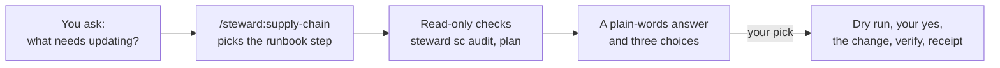

# Claude Code skills

**Ask in plain words.** The steward ships a Claude Code plugin, `steward`, with one skill per area. You say what you
want ("what needs updating?", "is this advisory a problem here?", "set up this repo"). The skill finds the matching
procedure in its runbook, runs the read-only checks, explains what they found, and asks before anything changes.

You don't need to know the CLI's forty-odd commands and their flags to get the value out of them. The skills do,
and they follow the same rules the commands do: the 3-day release-age gate, majors as your call, a plan before every
change, a backup and a receipt after it.



## Contents

- [Install](#install)
- [Things you can ask](#things-you-can-ask)
- [See it work](#see-it-work)
- [What the skills do, and never do](#what-the-skills-do-and-never-do)
- [The skills](#the-skills)

## Install

`steward skills install` shows what it will install, what it changes and how to undo it, then asks. `steward init`
offers the same choice during setup.



```sh
steward skills install                      # for you: every Claude Code session, in any folder
steward skills install --project <path>     # only sessions started in that project
steward skills uninstall                    # the way back (add --project <path> for a project install)
```

> [!CAUTION]
> Run `steward skills install` in your own terminal, not from inside a Claude Code session. Claude Code accepts a
> plugin's command only from a person, so the install stops and tells you so.

- **They follow your steward.** Each session, Claude Code runs `steward skills path`, which builds the plugin from
  your installed steward. The skills match your version and your add-ons, and nothing is fetched from the network.
- **They follow your add-ons.** `/steward:ai-tooling` and `/steward:projects` appear when those add-ons are on, and
  `/steward:pr-consolidation` when `[skills] pr_consolidation = true` in `steward.toml`.
- **A session starts knowing what needs you.** The plugin carries one read-only hook. When a session starts, after
  `/clear` and after a compaction, it runs `steward brief --hook`. When something needs you, you see the briefing's
  lines once (until what needs you changes, or 12 hours pass), and Claude gets the one next step with its command.
  A step Claude was to mention comes back if you left that session before Claude replied.
  When nothing does, it says nothing. `[brief] session = false` in `steward.toml` leaves the hook out
  ([the briefing](../docs/briefing.md#in-claude-code-the-session-start-hook)).
- **Claude Code 2.1.292 or newer.** The install checks the version.
- **Working on the steward itself?** `just claude` starts a session with your clone's skills, ahead of any installed
  release. After editing a skill, run `/reload-plugins`.

## Things you can ask

Ask in your own words; Claude picks the skill whose description matches. You can also name it: `/steward:supply-chain`,
or with a read-only report, `/steward:supply-chain audit`.

| Skill | Ask | What happens |
| --- | --- | --- |
| Supply chain | "What needs updating on this Mac?" | Audit and plan, sorted into *now*, *waiting for the gate* and *your call*; then a choice |
| | "Apply the upgrades" | The dry run, your yes, the upgrade, `steward sc verify`, and how to roll back |
| | "A Node security release is out" | Checks nodejs.org for your Node line; if it's a security release, patches it with `steward sc node-patch` after your yes |
| | "Is this advisory a problem here?" (paste the link) | Reads the advisory at its source, sweeps the machine read-only, and answers; any fix is a separate yes |
| | "Handle this Renovate PR" | Reads its release notes, age and provenance, checks its lock file, and says whether to merge or re-lock first |
| | "Roll back the last upgrade" | Shows the backup it would restore, then asks |
| AI tooling (add-on) | "Is the AI tooling OK?" | `steward ai drift`, explained, with the fix for each finding |
| | "A new agentic-qe release is out" | Its age, its security notes, and whether to qualify it |
| | "Qualify AQE 3.15.x" | Walks the qualification recipe, with backups and receipts |
| Projects (add-on) | "What new projects are there?" | `steward projects scan`, with each new project's evidence and your options |
| | "I just cloned a repo. Set it up." | Records your decision, then the onboard plan for the tools you chose, then your yes |
| | "Which tools does this project use?" | Its registry entry and what's really in the project |
| Fix | "Fix it" or "do what's next" | The work list: what your `[autonomy]` level lets run, runs; each other change, one yes at a time; your steps handed to you; one summary |
| | "Handle what the review found" | The same for a `steward review`'s items; a fleet repo or a qualification can go to a sub-agent |
| PR consolidation | "Consolidate the Dependabot PRs in owner/repo" | One verified PR in place of the bot PRs, with CI audits green; you merge it |
| | "Clear the security audit and the bot PRs" | The same, with every ignored advisory justified in the PR |

## See it work

These sessions are illustrative: the commands and their output are real, and the names and versions are examples.

### What needs updating?

The supply-chain skill runs the audit and the plan without asking, because both are read-only. It sorts what they
found by what you can do about it, then offers a choice. The upgrade itself is a separate yes.



### Is this advisory a problem here?

It reads the advisory at its source, not a social post about it. Then it checks the machine read-only and answers.



### Set up a new repo

The projects skill shows what it found in the repo and asks how to treat it. Then it shows the onboard plan and asks
again before writing anything.



### Is the AI tooling OK?

The ai-tooling skill explains a drift finding in terms of what breaks and when, then fixes it after your yes.



### PR consolidation

The README shows a real run: [`pacphi/ampel#86`](https://github.com/pacphi/ampel/pull/86), three Dependabot PRs and
twelve RustSec fixes in one PR ([see it](../README.md#pr-consolidation-in-claude-code)).

## What the skills do, and never do

| They… | How |
| --- | --- |
| Run read-only commands freely | `audit`, `plan`, `status`, `verify`, `drift`, `scan`, `list` and every `DRY_RUN=1` preview run without a prompt |
| Ask before each change | One yes covers one step, never the next. Claude Code asks too, before it runs a command that writes |
| Offer choices you can click | About three options, the recommended one first and marked "(Recommended)" |
| Hand you what needs you | Trust-store changes and anything with `sudo` go to you to run in Terminal; browsers and apps update from their own menus |
| Report what really happened | No success without a check that ran; failures come with their output |

They never run `mise upgrade node` (Node goes through `steward sc node-patch`) or plain `npm doctor`; never add
launchd or cron jobs; never start an AI tool with `@latest` or open its private stores; never add AI tools a project
didn't choose, or edit a project's tracked files (those go through a pull request); and PR consolidation never
merges.

## The skills

| Skill | Turned on by | Read-only reports | Its files |
| --- | --- | --- | --- |
| `/steward:supply-chain` | Always | `audit`, `plan` (or its old name, `status`), `verify` | [README](supply-chain/README.md), [runbook](supply-chain/runbook.md) |
| `/steward:fix` | Always | the plan (`steward fix`) | [README](fix/README.md) |
| `/steward:ai-tooling` | `[profiles] ai_tooling` | `drift` | [README](ai-tooling/README.md), [runbook](ai-tooling/runbook.md), [qualification](ai-tooling/qualification.md) |
| `/steward:projects` | `[profiles] projects` | `scan`, `list` | [README](projects/README.md), [runbook](projects/runbook.md) |
| `/steward:pr-consolidation` | `[skills] pr_consolidation` | (none) | [README](pr-consolidation/README.md), [rules](pr-consolidation/rules.md) |

Each skill is a folder with its `SKILL.md` (what Claude reads) and the runbook or rules it follows. How they're built
and loaded is D48 in [`docs/architecture.md`](../docs/architecture.md#decisions).
